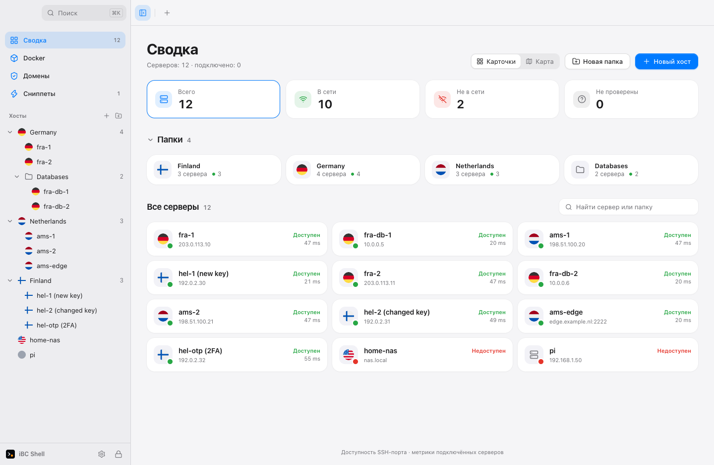
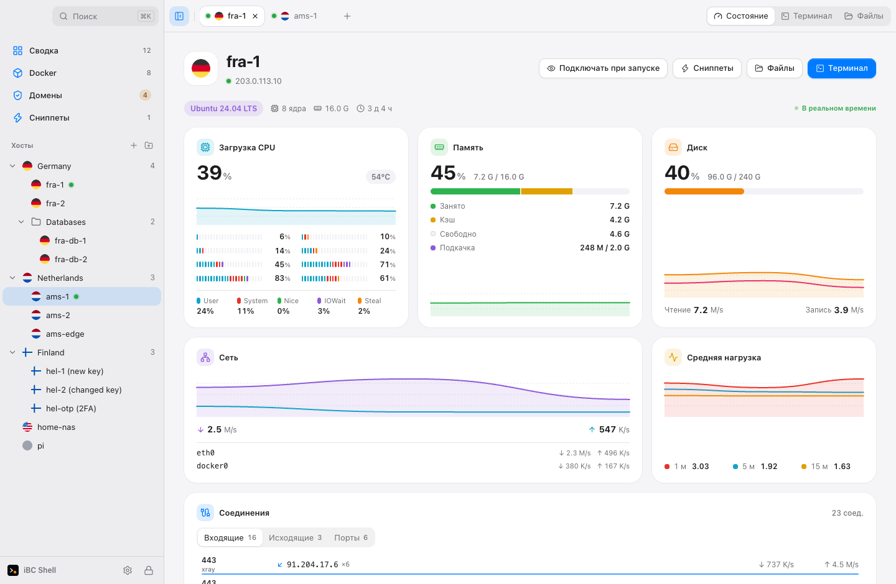
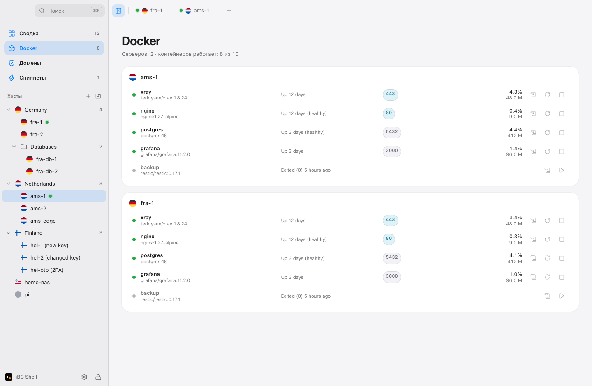
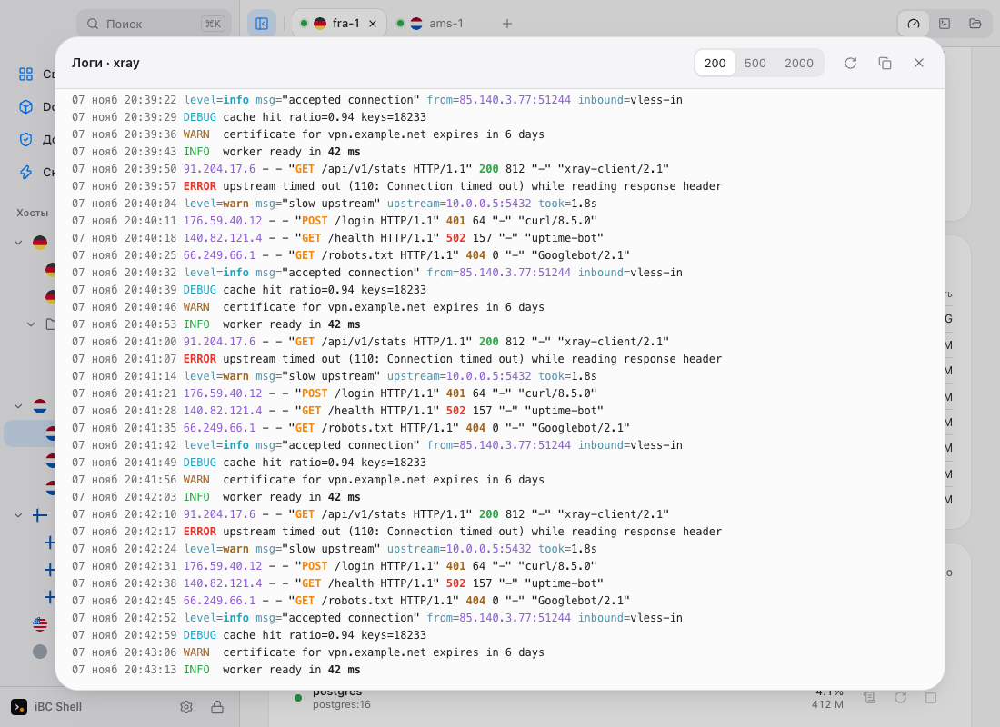
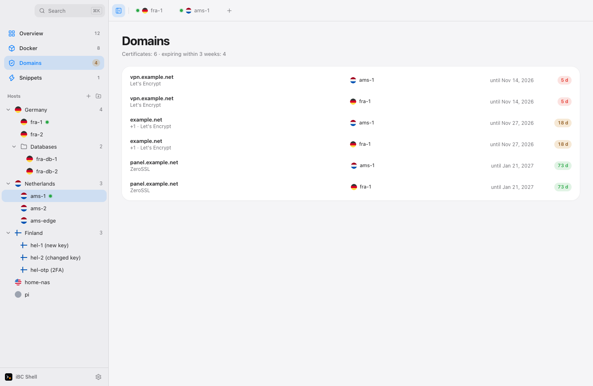

<p align="center">
  <picture>
    <source media="(prefers-color-scheme: dark)" srcset="docs/brand/logo/logo-white.svg">
    
  </picture>
</p>

# iBC Shell

**English** · [Русский](README.md)

A light SSH and SFTP client for people who run many servers.
Nested folders, country flags, a terminal that stays out of your way, and secrets that never leave your machine.

> **Status: early development.** The core (SSH, SFTP engine, encrypted vault, terminal and file UI) is built and tested.
> Installers are built automatically from a tag, see [Download](#download).

## Why

- **Light.** Small installer, low memory. Tauri and Rust, no Electron.
- **Servers by place.** Nested folders, each host with a country flag. Find a server by where it is, not by scrolling.
- **Honest security.** Host-key changes are a hard block, never auto-accepted. The vault state is always visible.
  No accounts, no cloud, nothing phones home.
- **Keyboard first.** Command palette on <kbd>⌘K</kbd> / <kbd>Ctrl K</kbd>. Russian and English UI.
- **Every server at a glance.** Searchable overview of saved servers, filtered by availability. SSH port checks need no login; connected Linux servers show live CPU, RAM and network activity, with load, disk and processes beside the terminal. No server agent.
- **Consistent desktop design.** System typography and shared buttons, fields and panels inspired by macOS. Light and dark themes. Terminals and file views retain their state when navigating between screens.

## Interface

<picture>
  <source media="(prefers-color-scheme: dark)" srcset="docs/brand/screenshots/overview-dark.png">
  
</picture>

Overview: folders, server availability, search.

<picture>
  <source media="(prefers-color-scheme: dark)" srcset="docs/brand/screenshots/status-dark.png">
  
</picture>

Server status: per-core CPU, memory, disk, network, connections.

<picture>
  <source media="(prefers-color-scheme: dark)" srcset="docs/brand/screenshots/docker-dark.png">
  
</picture>

Docker across all connected servers: state, ports, load, start, stop, restart.

<picture>
  <source media="(prefers-color-scheme: dark)" srcset="docs/brand/screenshots/logs-dark.png">
  
</picture>

Container logs in their own colours, with wrapped lines.

<picture>
  <source media="(prefers-color-scheme: dark)" srcset="docs/brand/screenshots/domains-dark.png">
  
</picture>

SSL certificate expiry for the domains on every server.

Demo mode: sample servers and metrics.

## What's new

- **A connection you can read.** Every step is shown: address lookup, connecting (to which IP), secure channel, sign-in, terminal, and how long each took. When it fails you see which step stopped and what that usually means (address not found, port closed, server dropped the connection, sign-in refused). There is a Copy report button. A dropped session is explained too.
- **Server configuration.** Cores, processor, memory and disk (NVMe, SSD or HDD) on the cards and in Status, like a hosting plan.
- **Backup.** Settings → Backup: one encrypted file with servers, folders, passwords and keys, snippets, trusted keys and settings. Open it on another computer with Restore and everything is back.
- **Docker.** A server's containers with state, ports and load; start, stop and restart (stop and restart ask first); logs. The Docker tab shows every connected server at once.
- **SSL certificates.** Finds Let's Encrypt, nginx, Apache and Caddy certificates, shows expiry and warns ahead. The Domains tab gathers them from all servers.
- **macOS menu-bar icon.** A short summary of your servers, one click to jump to a server. Can be turned off in settings.
- **Per-core CPU load** split into user, system, nice, iowait and steal.
- **Snippets without opening a server.** A tab of their own, run on one or several servers.
- **Folders on the overview**, a folder filter, connect a whole folder.
- **Everything over the SSH connection that is already open.** Nothing is installed on the server and no ports are opened.

## Download

Installers are on the [Releases page](https://github.com/dramaformama/ibc-shell/releases/latest), with a `SHA256SUMS.txt` next to them to verify the download.

| Platform             | File                        | State             |
| -------------------- | --------------------------- | ----------------- |
| macOS, Apple Silicon | `iBC Shell_…_aarch64.dmg`   | built in CI       |
| macOS, Intel         | `iBC Shell_…_x64.dmg`       | built in CI       |
| Windows 10/11        | `iBC Shell_…_x64-setup.exe` | built in CI       |
| Linux                | `.AppImage` and `.deb`      | built in CI       |
| iOS, Android         | —                           | planned (Phase 4) |

The builds are not signed with a paid certificate, so the system warns on first launch. That is expected; check the sum from `SHA256SUMS.txt`.

- **macOS.** Drag the app to Applications. On first launch right-click it, choose Open, then Open in the dialog. If macOS says the app is damaged, run `xattr -dr com.apple.quarantine "/Applications/iBC Shell.app"`.
- **Windows.** In the SmartScreen window click More info, then Run anyway.
- **Linux.** `chmod +x` the AppImage and run it, or `sudo apt install ./file.deb`.

A release is made by a tag: `git tag v0.1.0 && git push origin v0.1.0`. The [workflow](.github/workflows/release.yml) builds all four installers and puts them in a draft release that you publish by hand.

## What works today

| Area                                                                           | State                        |
| ------------------------------------------------------------------------------ | ---------------------------- |
| Encrypted vault (Argon2id + XChaCha20-Poly1305), host store, folder tree       | done, tested                 |
| SSH client: password, key, keyboard-interactive, host-key checks, jump hosts   | done, tested against OpenSSH |
| SFTP engine: queue, resume, pause, conflict policies, remote-to-remote         | done, tested                 |
| Terminal, files, overview, server status, Docker, SSL, snippets, menu-bar icon | done, working in the app     |
| Installers for macOS, Windows, Linux                                           | built in CI                  |
| Port forwarding, `ssh_config` import, key manager, split panes                 | planned (Phase 3)            |
| Mobile                                                                         | planned (Phase 4)            |

Tested on a Mac. Docker and SSL are checked on demo data, not yet on a real server. The Windows and Linux builds have not been run on real machines.

Nothing here is benchmarked against other clients yet. Numbers will go in `docs/bench.md` once they are measured.

## Build from source

You need Rust (stable), Node with pnpm, and [just](https://github.com/casey/just).

```sh
pnpm install
pnpm tauri dev          # run the app
cargo test --workspace  # Rust tests
pnpm -C ui check && pnpm -C ui test
just e2e                # integration tests against OpenSSH in Docker
```

## Layout

```
crates/store   SQLite, folder tree, inheritance
crates/vault   keys, secret encryption, backup format
crates/ssh     russh client: auth, host keys, PTY, forwards, jump hosts
crates/sftp    SFTP operations and the transfer engine
src-tauri      app shell: commands, channels, capabilities
ui             Svelte 5 interface
tests/docker   OpenSSH servers for integration tests
docs           plan, frozen contracts, ADRs, status
```

The plan lives in [docs/PLAN.md](docs/PLAN.md) (Russian), current progress in [docs/STATUS.md](docs/STATUS.md).

## Security

Passwords, private keys and passphrases never reach the UI layer except for the one thing you type.
There is no master password: your data is encrypted and the key sits in your computer's keychain, so the app opens at once. The protection is your Mac login and FileVault. If the keychain is lost (a new Mac, a reset) the vault cannot be opened, so keep a backup (it has its own password).
A changed host key blocks the connection. Remote strings are never rendered as HTML, and remote file names are sanitized before touching your disk.
The update check reads the public GitHub releases page, sends nothing about you, and can be turned off in Settings.
Details: [docs/contracts/security.md](docs/contracts/security.md).

## License

MIT, see [LICENSE](LICENSE).
