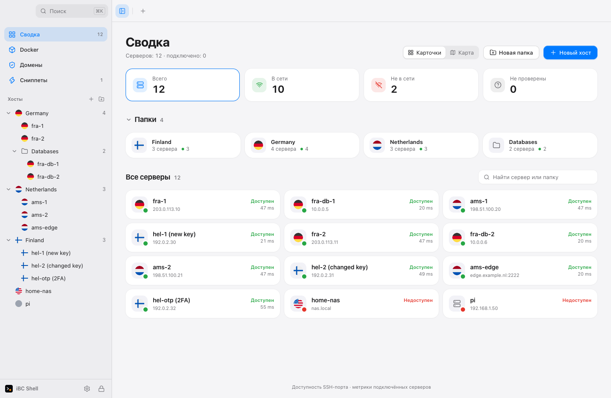
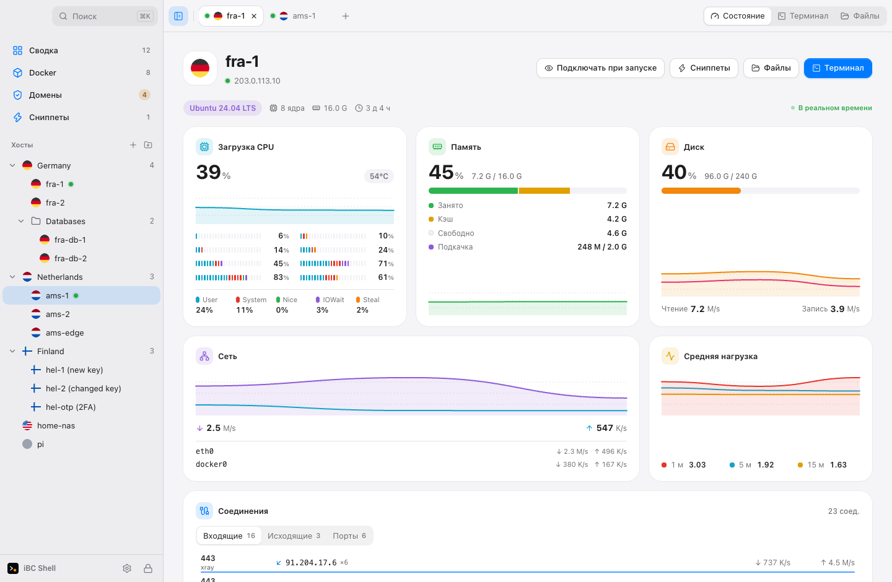
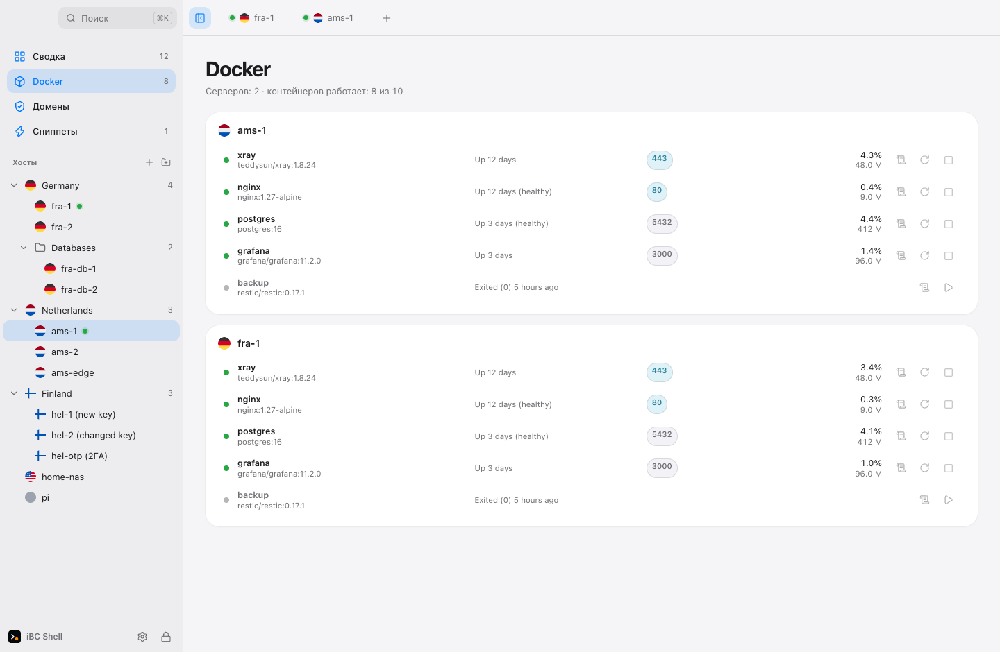
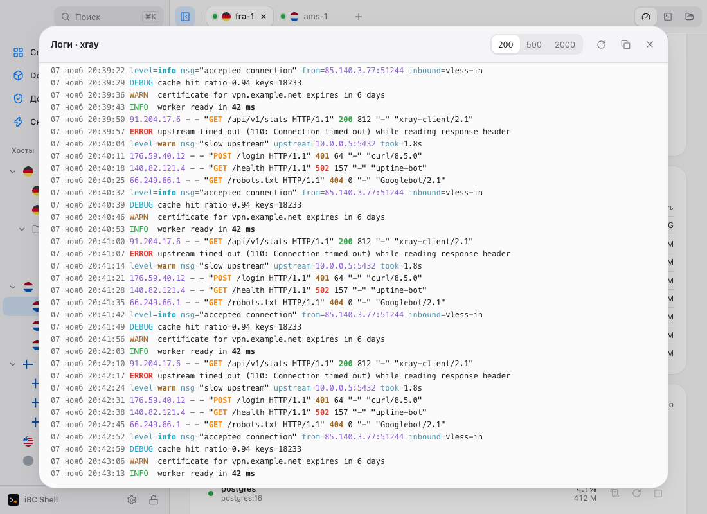
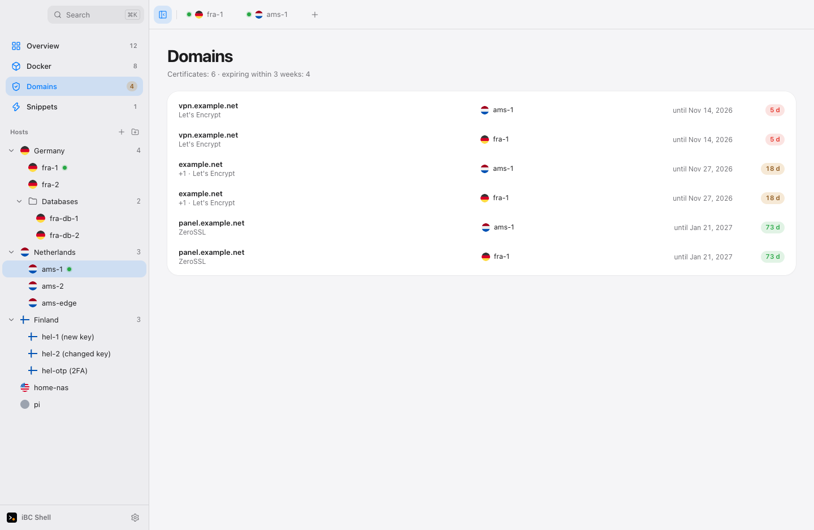

<p align="center">
  <picture>
    <source media="(prefers-color-scheme: dark)" srcset="docs/brand/logo/logo-white.svg">
    
  </picture>
</p>

# iBC Shell

[English](README.en.md) · **Русский**

Лёгкий SSH- и SFTP-клиент для тех, кто администрирует много серверов.
Вложенные папки, флаги стран, терминал, который не мешает, и секреты, которые не покидают ваш компьютер.

> **Статус: ранняя разработка.** Ядро (SSH, движок SFTP, зашифрованное хранилище, интерфейс терминала и файлов) написано и протестировано.
> Установщики собираются автоматически по тегу, см. [Скачать](#скачать).

## Зачем

- **Лёгкий.** Маленький установщик, мало памяти. Tauri и Rust, без Electron.
- **Серверы по месту.** Вложенные папки, у каждого хоста флаг страны. Сервер ищется по тому, где он стоит, а не прокруткой списка.
- **Честная безопасность.** Смена ключа хоста блокирует подключение, а не принимается молча. Состояние хранилища всегда на виду.
  Без аккаунтов, без облака, ничего не отправляется наружу.
- **Клавиатура прежде всего.** Палитра команд по <kbd>⌘K</kbd> / <kbd>Ctrl K</kbd>. Интерфейс на русском и английском, язык меняется в настройках.
- **Все серверы на главной.** Каталог с поиском и фильтрами доступности: SSH-порт проверяется без входа. У подключённых Linux-серверов — живые CPU, RAM и сеть, рядом с терминалом — инспектор нагрузки, диска и процессов. Без установки агента.
- **Единый интерфейс.** Системная типографика, общие кнопки, поля и панели в стиле macOS. Светлая и тёмная темы. Терминалы и файловые панели сохраняют своё состояние при переключении экранов.

## Интерфейс

<picture>
  <source media="(prefers-color-scheme: dark)" srcset="docs/brand/screenshots/overview-dark.png">
  
</picture>

Сводка: папки, доступность серверов, поиск.

<picture>
  <source media="(prefers-color-scheme: dark)" srcset="docs/brand/screenshots/status-dark.png">
  
</picture>

Состояние сервера: CPU по ядрам, память, диск, сеть, соединения.

<picture>
  <source media="(prefers-color-scheme: dark)" srcset="docs/brand/screenshots/docker-dark.png">
  
</picture>

Docker на всех подключённых серверах: состояние, порты, нагрузка, запуск, остановка, перезапуск.

<picture>
  <source media="(prefers-color-scheme: dark)" srcset="docs/brand/screenshots/logs-dark.png">
  
</picture>

Логи контейнера в его же цветах, с переносом строк.

<picture>
  <source media="(prefers-color-scheme: dark)" srcset="docs/brand/screenshots/domains-dark.png">
  
</picture>

Срок SSL-сертификатов доменов на всех серверах.

Деморежим: примерные серверы и метрики.

## Новые возможности

- **Docker.** Контейнеры сервера с состоянием, портами и нагрузкой, запуск, остановка и перезапуск (останов и перезапуск с подтверждением), логи. Вкладка «Docker» показывает все подключённые серверы разом.
- **SSL-сертификаты.** Находит сертификаты Let's Encrypt, nginx, Apache и Caddy, показывает срок и предупреждает заранее. Вкладка «Домены» собирает их со всех серверов.
- **Значок в строке меню macOS.** Краткая сводка по серверам, переход к серверу в один клик. Отключается в настройках.
- **Нагрузка CPU по ядрам** с разбивкой на user, system, nice, iowait и steal.
- **Сниппеты без захода на сервер.** Отдельная вкладка, запуск на одном или на нескольких серверах.
- **Папки на сводке**, фильтр по папке, подключение всей папки.
- **Всё через уже открытое SSH-соединение.** Ничего не устанавливается на сервер, никакие порты не открываются.

## Скачать

Установщики лежат на странице [Releases](https://github.com/dramaformama/ibc-shell/releases/latest). Рядом файл `SHA256SUMS.txt` для проверки загрузки.

| Платформа            | Файл                        | Состояние         |
| -------------------- | --------------------------- | ----------------- |
| macOS, Apple Silicon | `iBC Shell_…_aarch64.dmg`   | собирается в CI   |
| macOS, Intel         | `iBC Shell_…_x64.dmg`       | собирается в CI   |
| Windows 10/11        | `iBC Shell_…_x64-setup.exe` | собирается в CI   |
| Linux                | `.AppImage` и `.deb`        | собирается в CI   |
| iOS, Android         | —                           | в планах (Фаза 4) |

Сборки не подписаны платным сертификатом, поэтому система предупредит при первом запуске. Это нормально, проверьте сумму из `SHA256SUMS.txt`.

- **macOS.** Перетащите приложение в «Программы». При первом запуске нажмите правой кнопкой, «Открыть», затем «Открыть» в окне. Если macOS пишет, что приложение повреждено, выполните `xattr -dr com.apple.quarantine "/Applications/iBC Shell.app"`.
- **Windows.** В окне SmartScreen нажмите «Подробнее», затем «Выполнить в любом случае».
- **Linux.** `chmod +x` на AppImage и запуск, либо `sudo apt install ./файл.deb`.

Выпуск делается тегом: `git tag v0.1.0 && git push origin v0.1.0`. [Workflow](.github/workflows/release.yml) собирает все четыре установщика и кладёт их в черновик релиза, который вы публикуете вручную.

## Что работает сейчас

| Область                                                                                   | Состояние                     |
| ----------------------------------------------------------------------------------------- | ----------------------------- |
| Зашифрованное хранилище (Argon2id + XChaCha20-Poly1305), база хостов, дерево папок        | готово, протестировано        |
| SSH-клиент: пароль, ключ, keyboard-interactive, проверка ключа хоста, прыжки через хосты  | готово, проверено на OpenSSH  |
| Движок SFTP: очередь, докачка, пауза, политики конфликтов, передача между серверами       | готово, протестировано        |
| Терминал, файлы, сводка, состояние сервера, Docker, SSL, сниппеты, значок в строке меню   | готово, работает в приложении |
| Установщики для macOS, Windows, Linux                                                     | собираются в CI               |
| Проброс портов, импорт `ssh_config`, менеджер ключей, разделение панелей, резервные копии | в планах (Фаза 3)             |
| Мобильные платформы                                                                       | в планах (Фаза 4)             |

Проверено на Mac. Docker и SSL проверены на демо-данных, на реальном сервере ещё нет. Сборки для Windows и Linux не запускались на реальных машинах.

Сравнения с другими клиентами пока нет. Замеры появятся в `docs/bench.md`, когда будут сняты.

## Сборка из исходников

Нужны Rust (stable), Node с pnpm и [just](https://github.com/casey/just).

```sh
pnpm install
pnpm tauri dev          # запустить приложение
cargo test --workspace  # тесты Rust
pnpm -C ui check && pnpm -C ui test
just e2e                # интеграционные тесты на OpenSSH в Docker
```

## Структура

```
crates/store   SQLite, дерево папок, наследование настроек
crates/vault   ключи, шифрование секретов, формат резервной копии
crates/ssh     клиент на russh: вход, ключи хостов, PTY, проброс, прыжки
crates/sftp    операции SFTP и движок передач
src-tauri      оболочка приложения: команды, каналы, права
ui             интерфейс на Svelte 5
tests/docker   серверы OpenSSH для интеграционных тестов
docs           план, замороженные контракты, ADR, статус
```

План лежит в [docs/PLAN.md](docs/PLAN.md), текущий прогресс в [docs/STATUS.md](docs/STATUS.md).

## Безопасность

Пароли, приватные ключи и парольные фразы не попадают в слой интерфейса, кроме того единственного, что вы вводите сами.
Мастер-пароля нет: данные зашифрованы, а ключ лежит в связке ключей вашего компьютера, поэтому приложение открывается сразу. Защита здесь это вход в ваш Mac и FileVault. Если связка ключей потеряется (новый Mac, сброс), хранилище не открыть, поэтому делайте резервную копию (она защищена отдельным паролем).
Изменённый ключ хоста блокирует соединение. Строки с сервера никогда не отображаются как HTML, а имена удалённых файлов очищаются до того, как коснутся вашего диска.
Проверка обновлений читает публичную страницу релизов на GitHub, ничего о вас не отправляет и отключается в настройках.
Подробности: [docs/contracts/security.md](docs/contracts/security.md).

## Лицензия

MIT, см. файл [LICENSE](LICENSE).
