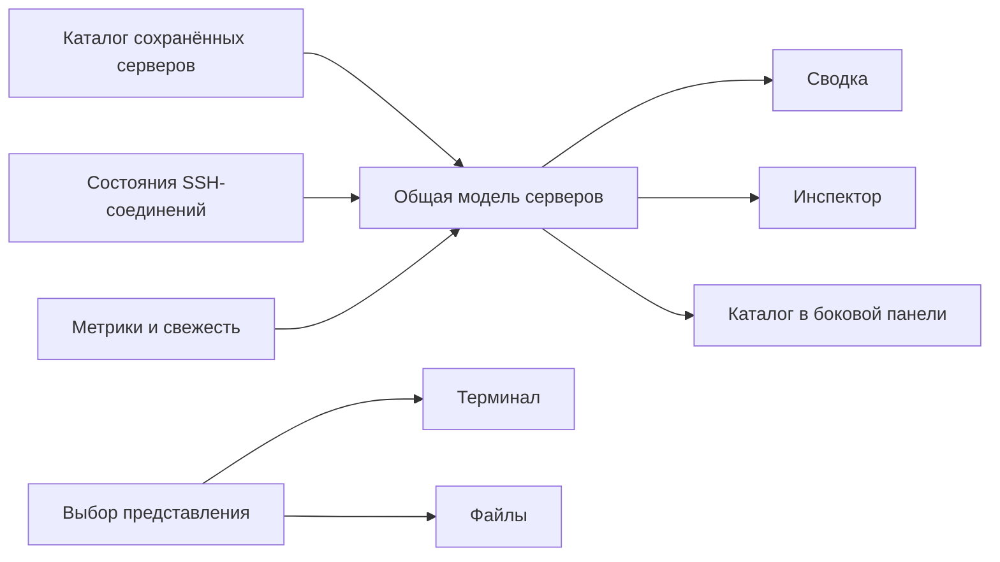

# SwiftServer: ориентиры для iBC Shell

Исследовано 2026-11-07. Только первичные источники: документация SwiftServer, публичный README Traversio, Apple HIG. Чужие ассеты, бренд и код не переносятся. Это исследование и рекомендации; принятые контракты iBC Shell оно не изменяет.

## Что подтверждено

| Область | Подтверждённое поведение | Источник |
| --- | --- | --- |
| Каталог и мониторинг | Сохранённые машины и машины в мониторинге различаются: переключатель Show Status in Dashboard включает карточку. Количество сохранённых хостов независимо от лимита мониторинга. | [Monitoring](https://swiftserver.app/features/monitoring) |
| Главная | Карточки показывают состояние, CPU/RAM, сеть и дисковый I/O, ресурсы, аптайм, температуру и задержку. Нажатие ведёт к подробному состоянию машины. | [Monitoring](https://swiftserver.app/features/monitoring) |
| Состояния | Online означает поступающий мониторинг. Connecting, Awaiting Trust и Error различаются. Ошибки ведут к диагностике. | [Dashboard docs](https://swiftserver.app/docs/monitoring) |
| Сбор метрик | Read-only команды по SSH без установленного агента. Сначала определяется ОС, затем выбирается сборщик. Linux, macOS и Windows имеют разные возможности. | [Dashboard docs](https://swiftserver.app/docs/monitoring) |
| Планировщик | Интервал 1–60 с, по умолчанию 5 с; пауза отсчитывается после ответа, запросы не накапливаются. Долгие показатели обновляются реже. | [Dashboard docs](https://swiftserver.app/docs/monitoring), [Monitoring](https://swiftserver.app/features/monitoring) |
| История | История метрик остаётся в памяти приложения; долговременная сетевая история берётся из vnStat на сервере. | [Monitoring](https://swiftserver.app/features/monitoring) |
| Терминал | Запускается из каталога/сводки/состояния; работающие сессии отдельны от машин. Инспектор рядом с shell содержит Status и Snippets. Reconnect запускает новый shell. | [Terminal docs](https://swiftserver.app/docs/terminal) |
| SFTP | Собственные сессии и keepalive, независимо от настройки терминала. Передача сервер → сервер идёт через клиент. При разрыве доступна диагностика. | [SFTP docs](https://swiftserver.app/docs/sftp) |
| SSH-ядро | Traversio предоставляет долгоживущий SSHConnection, от которого создаются shell, exec, SFTP, forwards. Закрытие соединения инвалидирует дочерние сущности. Scoped withConnection закрывает его при выходе. Reconnect, credentials и operational policy принадлежат приложению. | [Traversio README](https://github.com/GitSwiftHQ/Traversio/blob/main/README.md) |

Внутренняя модель SwiftServer, конкретный менеджер соединений и правила разделения транспорта между всеми режимами не опубликованы в этих источниках. Публичная архитектура Traversio не доказывает точную реализацию SwiftServer.

## Рекомендуемая модель iBC Shell

Это наше проектное решение на основе наблюдаемого поведения, а не описание закрытого кода SwiftServer.

- **Каталог существует без вкладок.** Сводка строится из сохранённых хостов; закрытие терминала не удаляет карточку сервера. Быстрые подключения могут добавляться отдельно, пока их сессия открыта.
- **Представление не владеет подключением.** Выбор сводки, терминала или файлов меняет видимость. Соединение и его состояние имеют собственный срок жизни. Это seam для последующего мониторинга без открытого PTY.
- **Один модуль серверов собирает состояние.** Его интерфейс возвращает карточке имя/адрес/группу, состояние подключения, доступную сессию, последнюю метрику и свежесть. Карточки не ищут самостоятельно данные в нескольких stores.
- **Неподключённый сервер не обязательно выключен.** Без проверки доступности показывать «Не подключён»; после ошибки — «Ошибка подключения». Зелёный статус должен подтверждаться живой сессией/свежими данными, а не наличием вкладки.
- **Метрики отделены от соединения.** Состояния waiting / fresh / stale / unsupported / error и время последней успешной выборки не смешивать с состоянием SSH. Старые числа явно помечать, пропуски не подменять нулём.
- **Один опрос на соединение.** Подписки карточки и инспектора используют общий цикл. Удаление последней подписки останавливает следующие запросы; завершившийся запрос не оживляет закрытую сессию. Текущая ADR-009 остаётся источником правил интервала и auto-lock.
- **Будущее Rust-углубление.** Менеджер соединений в src-tauri может выдавать владельцам channel/session handles для terminal, stats и SFTP, а закрывать transport после последнего владельца или lock. Нужны явные правила владения, отмены и новая ADR до изменения IPC. SSH/SFTP crates по-прежнему не зависят от store/vault.

## Единый Apple-style интерфейс

Рекомендации для нашей кроссплатформенной реализации; WebView не становится нативным SwiftUI-приложением от CSS.

1. Общие tokens размеров, радиусов, поверхностей, типографики и состояний. Четыре роли кнопок: primary, secondary, toolbar и destructive. Связанные кнопки одного размера; выделение primary сообщает приоритет действия. [Apple: Buttons](https://developer.apple.com/design/human-interface-guidelines/buttons)
2. Постоянная навигация — в sidebar, действия текущего экрана — в toolbar, вспомогательная информация — в inspector. Sidebar можно скрыть; иконки имеют понятные подписи/tooltip, цвет служит смыслу. [Apple: Sidebars](https://developer.apple.com/design/human-interface-guidelines/sidebars)
3. В карточке крупные полезные числа, короткая строка ресурсов, компактные кольца, графики и ровные отступы. Цветные заголовки разделов помогают ориентации; обычные действия используют общий акцент. Не раскрашивать все элементы одновременно.
4. Сводка открывается сразу с каталогом. Поиск и фильтр состояния действуют на серверы. Есть понятные пустые состояния: каталог пуст, фильтр ничего не нашёл, метрики недоступны.
5. Видимость метрик не должна требовать повторной авторизации при каждом переключении. Ошибка соединения, ожидание host-key trust и неподдерживаемые метрики показываются явно, без автоматического доверия ключам.
6. Режимы светлый/тёмный, клавиатурный фокус, reduced motion и узкое окно проверять на тех же общих элементах, а не отдельными наборами стилей.
